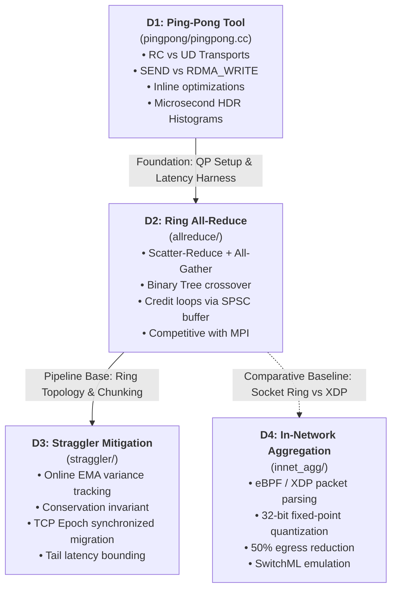
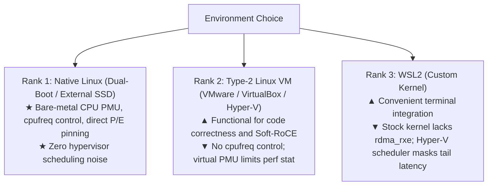

# Field Manual: Project Adder

## Table of Contents
* **Part 0: Orientation**
  * 0.1 The Big Picture: Why RDMA Exists & The AI Infrastructure Imperative (NCCL, Mooncake, KV-Cache, GPUDirect)
  * 0.2 Project Deliverables Architecture (D1, D2, D3, D4)
  * 0.3 Conceptual Dependency Map & Project Phase Mapping
  * 0.4 The Exhaustive Systems & Verbs Glossary
  * 0.5 Summary: If You Remember Nothing Else
* **Part 1: Environment and Tooling (on Windows)**
  * 1.1 The Linux Testbed Options: Ranked from Bare-Metal to WSL2
  * 1.2 Soft-RoCE (`rdma_rxe`) Architecture, Setup, and the Loopback Trap
  * 1.3 Establishing Perftest Baselines (`ib_send_lat`, `ib_write_lat`, `ib_send_bw`)
  * 1.4 Network Namespaces and Virtual Ethernet (`veth`) Pairs
  * 1.5 Memory Locking (`memlock` / `RLIMIT_MEMLOCK`) Mechanics
  * 1.6 The Low-Latency Toolbox: 1-Line Roles & Exact Invocations
  * 1.7 Multi-Language Build Gotchas: Mixing C++23, C23, and eBPF `gnu11`
  * 1.8 Summary: If You Remember Nothing Else
* **Part 2: RDMA and Verbs Fundamentals**
* **Part 3: Measuring Latency Correctly**
* **Part 4: Collective Communication**
* **Part 5: Straggler Detection and Scheduling**
* **Part 6: eBPF/XDP and In-Network Aggregation (Stretch)**
* **Part 7: C++23 / C23 Practices for This Codebase**
* **Part 8: The Cross-Cutting Lists (Mistakes, Pitfalls, Tips, Playbook, Interview Questions)**
* **Part 9: Learning Path and Primary Sources**

---

# Part 0: Orientation

---

### 0.1 The Big Picture: Why RDMA Solves the AI Infrastructure Bottleneck

#### Why it matters here
In Project Adder, you are moving lock-free IPC primitives (such as the single-producer single-consumer ring buffers from Icarus) across machine boundaries. To achieve sub-10-microsecond synchronization, you must bypass the operating system kernel.

#### Mental Model
Traditional TCP/IP is like mailing a letter through a postal bureaucracy. Your application writes data; the kernel copies it into an `sk_buff`; the network stack calculates checksums and adds TCP/IP headers; an interrupt fires; the NIC sends it. On the receiving end, an interrupt wakes the OS; the kernel parses the headers, copies the payload into a socket buffer, and unblocks your waiting thread via a context switch.

RDMA is a pneumatic dispatch tube directly between two desks. The network adapter (HCA/RNIC) contains a hardware DMA engine. Your application writes a descriptor directly to a memory-mapped hardware doorbell register. The NIC reads the data straight out of host physical RAM via PCIe DMA, transmits it across the wire, and writes it directly into the remote host's physical RAM. The remote operating system kernel is completely oblivious to the transfer.

```
Traditional TCP/IP Stack:
[ User App ] ---> [ Kernel sk_buff ] ---> [ Driver / TCP Stack ] ---> [ NIC ] (Copies + Interrupts + Syscalls)
    ^                                                                     |
    +----------- 15–50 µs latency / high CPU overhead per byte <----------+

True RDMA (Kernel Bypass + Zero-Copy):
[ User App ] -----------------(MMIO Doorbell)------------------------> [ NIC ]
[ Pinned RAM ] <=================(PCIe Direct DMA)==================== [ Wire ]
    ^
    +----------- 0.6–1.5 µs latency / 0% CPU consumption
```

#### Core Details
Modern Distributed AI systems cannot scale without RDMA:
1. **NCCL (NVIDIA Collective Communications Library)**: Synchronizes multi-billion parameter model gradients during distributed data-parallel (DDP) and tensor-parallel (TP) training. Gradients are accumulated across thousands of GPUs using All-Reduce. Over TCP, CPU socket buffers and context switches bottleneck GPU compute engines. NCCL uses verbs over InfiniBand or RoCEv2.
2. **GPUDirect RDMA**: Allows the NIC to DMA data directly into and out of GPU High-Bandwidth Memory (HBM) over the PCIe root complex or NVLink fabric, bypassing CPU host RAM entirely.
3. **Disaggregated LLM Serving (Mooncake / KV-Cache Transport)**: Modern LLM inference splits execution into a **prefill phase** (compute-bound, long prompt processing) and a **decode phase** (memory-bandwidth-bound token generation). Moving large Key-Value (KV) caches (gigabytes per user request) between prefill clusters and decode clusters requires hundreds of gigabits of zero-copy RDMA throughput.

---

### 0.2 Project Deliverables Architecture

Project Adder breaks into four cohesive systems deliverables:



* **D1 (Ping-Pong Latency Harness)**: Teaches you the raw verbs API, memory registration, queue pair (QP) state machines (RESET $\to$ INIT $\to$ RTR $\to$ RTS), and high-resolution timing.
* **D2 (Ring All-Reduce)**: Teaches you how to pipeline chunks, manage flow control using credit loops to avoid hardware Receiver Not Ready (RNR) deadlocks, and implement bandwidth-optimal topologies.
* **D3 (Straggler-Aware Scheduling)**: Teaches you real-world distributed systems stability. In large clusters, one degraded node slows the entire synchronous step. You build online variance detection and dynamic chunk re-scheduling.
* **D4 (In-Network Aggregation)**: Introduces kernel data-plane programming with eBPF/XDP to accumulate fixed-point tensors directly in the network driver before they reach userspace.

---

### 0.3 Conceptual Dependency Map & Project Phase Mapping

```mermaid
flowchart LR
    subgraph "Phase 1: Environment"
        C1["Linux OS / Namespaces"] --> C2["rdma_rxe Setup"]
        C2 --> C3["perftest Baseline"]
    end

    subgraph "Phase 2: Verbs Transport (D1)"
        C3 --> C4["Memory Registration (MR)"]
        C4 --> C5["QP States (INIT/RTR/RTS)"]
        C5 --> C6["RC vs UD / Two-Sided vs One-Sided"]
    end

    subgraph "Phases 3-4: Collectives (D2)"
        C6 --> C7["α-β Performance Model"]
        C7 --> C8["Ring: Scatter-Reduce + All-Gather"]
        C8 --> C9["Credit Loops & Flow Control"]
    end

    subgraph "Phases 5-6: Tail Latency (D3)"
        C9 --> C10["EMA Latency Variance"]
        C10 --> C11["Dynamic Work Rebalancing"]
        C11 --> C12["Epoch Coordination"]
    end

    subgraph "Phase 9: eBPF/XDP (D4)"
        C7 --> C13["XDP / TC Drivers"]
        C13 --> C14["Fixed-Point Quantization"]
    end
```



| Phase | Milestone | Concepts Required |
|---|---|---|
| **Phase 1** | Soft-RoCE verified with `perftest` | Kernel modules, `rxe` links, netdevs, `memlock` |
| **Phase 2** | `pingpong.cc` operational (RC & UD) | PD, MR, CQ, QP state transitions, out-of-band TCP exchange, HDR histograms |
| **Phase 3** | Ring All-Reduce single-node correct | Chunk slicing, modular arithmetic $(i+k) \pmod N$, bit-exact verification |
| **Phase 4** | Multi-node scaling & MPI comparison | SPSC credit loops, RNR prevention, $\alpha$-$\beta$ crossover, core pinning |
| **Phase 5** | Straggler detection & scheduler | Exponential moving average (EMA), $2\sigma$ thresholds, conservation invariant |
| **Phase 6** | Tail latency mitigation validated | Synthetic injection (spin/sleep/cgroups), epoch synchronization |
| **Phase 7** | Methodology & documentation | Provenance tracking, `gap_analysis.md`, reproducible artifacts |
| **Phase 8** | Cross-host cloud run (Optional) | Cloud VPCs, MTU configuration, heterogeneous network routing |
| **Phase 9** | In-network aggregation (Stretch) | XDP hooks, BPF maps, fixed-point math, verifier bounds |

---

### 0.4 The Exhaustive Systems & Verbs Glossary

| Term | Expansion | Exact Definition & Role in Adder |
|---|---|---|
| **HCA** | Host Channel Adapter | The physical expansion card providing an InfiniBand interface. Contains dedicated hardware transport engines. |
| **RNIC** | RDMA-enabled Network Interface Card | An Ethernet network interface card containing hardware offload logic for RoCEv1, RoCEv2, or iWARP. |
| **Verbs** | RDMA Verbs API | The standardized interface (`libibverbs`) defined by the OpenFabrics Alliance (OFA) providing direct user-space access to RDMA hardware. |
| **PD** | Protection Domain | A kernel-managed security domain that binds Queue Pairs, Memory Regions, and Address Handles together. Entities in different PDs cannot interact. |
| **MR** | Memory Region | A contiguous range of virtual user memory that has been pinned into physical RAM by the kernel and registered with the HCA. |
| **lkey** | Local Key | A 32-bit cryptographic handle returned by `ibv_reg_mr`. Must accompany every local buffer reference in Scatter/Gather Elements so the HCA hardware can validate access permissions. |
| **rkey** | Remote Key | A 32-bit authorization token exchanged out-of-band with remote nodes, allowing the remote node to perform one-sided `RDMA_READ` or `RDMA_WRITE` operations directly into that memory. |
| **CQ** | Completion Queue | An in-memory queue containing Completion Queue Elements (CQEs) written by the HCA when an asynchronous Work Request completes. |
| **QP** | Queue Pair | The fundamental endpoint of RDMA communication, consisting of a Send Queue (SQ) and a Receive Queue (RQ). |
| **WR** | Work Request | The software descriptor structure (`ibv_send_wr` or `ibv_recv_wr`) created by the application and passed to `ibv_post_send` or `ibv_post_recv`. |
| **WQE** | Work Queue Element | Pronounced *"wookie"*. The hardware-specific representation of a Work Request formatted by the user-space driver and placed onto the QP ring buffer. |
| **CQE** | Completion Queue Element | Pronounced *"cookie"*. The hardware-specific descriptor written into the Completion Queue by the HCA upon completing a WQE. Exposed to user space as `struct ibv_wc`. |
| **SGE** | Scatter/Gather Element | A tuple `{uint64_t addr, uint32_t length, uint32_t lkey}` describing a discrete memory segment for network transmission or reception. |
| **PSN** | Packet Sequence Number | A 24-bit modulo counter tracking in-flight packets on connected transports (RC) to ensure in-order delivery and trigger hardware retransmissions upon packet loss. |
| **QPN** | Queue Pair Number | A 24-bit identifier uniquely designating a Queue Pair within an HCA. |
| **LID** | Local Identifier | A 16-bit subnet address assigned to an InfiniBand port by the Subnet Manager. **Unused in pure Ethernet RoCE networks** (where LID=0). |
| **GID** | Global Identifier | A 128-bit globally unique address formatted identically to an IPv6 address. In RoCEv2, GIDs map directly to IPv4 or IPv6 network addresses. |
| **GRH** | Global Routing Header | A 40-byte routing header prepended to RoCE packets. On UD receives, the HCA places these 40 bytes directly into the head of your receive buffer. |
| **AH** | Address Handle | A hardware object representing a network path to a remote destination (containing destination GID, traffic class, and hop limit). Required for UD sends. |
| **Q_Key** | Queue Key | A 32-bit authorization key configured in UD QPs. An incoming UD datagram is dropped unless its Q_Key matches the local QP's Q_Key. |
| **RC** | Reliable Connected | A connection-oriented transport (one QP connects to exactly one remote QP). Provides in-order delivery, hardware retries, and supports both two-sided and one-sided operations. |
| **UC** | Unreliable Connected | Connected transport without hardware ACKs or retransmission. Drops lost packets. Rarely used in production. |
| **UD** | Unreliable Datagram | Connectionless, unreliable transport (one QP can send to any UD QP on the network). Messages cannot exceed the path MTU; only supports two-sided `SEND/RECV`. |
| **RNR** | Receiver Not Ready | An error condition occurring when an incoming Send packet arrives at a QP whose Receive Queue has no posted buffers. Triggers an RNR NAK packet. |
| **MTU** | Maximum Transmission Unit | The maximum payload size of a single RDMA network packet. In verbs, configured via enum `ibv_mtu` (256, 512, 1024, 2048, 4096 bytes). |
| **RoCEv1** | RDMA over Converged Ethernet v1 | RDMA protocol encapsulated directly in Ethernet frames (Ethertype 0x8915). **Non-routable** across IP subnets. |
| **RoCEv2** | RDMA over Converged Ethernet v2 | Routable RDMA. Encapsulates InfiniBand transport packets inside UDP/IP packets targeting destination UDP port 4791. |
| **iWARP** | Internet Wide Area RDMA Protocol | RDMA layered over standard TCP/IP. Uses complex streaming semantics. Distinct from RoCE. |
| **SRQ** | Shared Receive Queue | A single receive queue shared across multiple distinct Queue Pairs, preventing the memory explosion of pre-posting buffers for every peer. |
| **Doorbell** | Doorbell Register | A memory-mapped I/O (MMIO) register on the physical NIC. Writing a 32-bit or 64-bit value to this address alerts the hardware that new WQEs are ready. |
| **Inline** | `IBV_SEND_INLINE` | An optimization where data is copied directly into the WQE rather than fetched via DMA. Eliminates the local PCIe read DMA transaction for small messages. |
| **Signaled** | `IBV_SEND_SIGNALED` | A flag on a Send WR indicating that completion of this request must generate a CQE in the Completion Queue. Unsignaled sends generate no CQE on success. |
| **All-Reduce** | Collective Operation | A distributed collective where every participating rank contributes an array of values, a reduction operator (e.g., sum) is applied, and all ranks receive the identical reduced array. |
| **Scatter-Reduce** | Collective Operation | The first phase of Ring All-Reduce: chunks are passed and accumulated around the ring such that each rank ends up with only its $1/N$ portion of the reduced tensor. |
| **All-Gather** | Collective Operation | The second phase of Ring All-Reduce: each rank broadcasts its fully reduced $1/N$ chunk around the ring until every rank possesses the complete reduced tensor. |
| **$\alpha$–$\beta$ Model** | Hockney Cost Model | Analytical communication model: $T = \alpha + \beta \cdot S$, where $\alpha$ is network startup latency, $\beta$ is transfer time per byte ($1/\text{Bandwidth}$), and $S$ is message size. |
| **P99.9** | 99.9th Percentile | The latency threshold below which 99.9% of observed operations fall. Represents tail latency behavior (1 out of every 1,000 requests). |
| **HDR Histogram** | High Dynamic Range Histogram | A data structure that records integer values with configurable logarithmic precision across a massive dynamic range with zero runtime allocations on the recording path. |
| **Coordinated Omission** | Measurement Fallacy | A critical benchmarking bug where measuring systems that stall fail to record the requests that *should* have been sent during the stall, artificially masking tail latency. |
| **SMT** | Simultaneous Multithreading | Intel Hyper-Threading. Multiple architectural execution contexts sharing a single physical CPU core's execution pipelines and caches. |
| **Governor** | CPU Frequency Governor | Kernel policy driver controlling dynamic frequency scaling (e.g., `performance`, `powersave`). Must be set to `performance` for low-latency testing. |
| **XDP** | eXpress Data Path | An eBPF-based high-performance packet processing framework that executes verified bytecode directly in the network driver before Linux allocates an `sk_buff`. |
| **TC** | Traffic Control | Linux kernel packet scheduling and filtering subsystem. Can inspect, modify, and clone (`bpf_clone_redirect`) packets at ingress or egress. |
| **Verifier** | eBPF Verifier | In-kernel static analysis engine that analyzes every possible execution branch of an eBPF program before loading, guaranteeing it cannot crash the kernel or loop infinitely. |
| **BPF Map** | eBPF Map | Kernel-managed key/value storage structures used for sharing state between eBPF programs and user-space applications. |
| **Fixed-Point** | Numerical Representation | Representing fractional numbers using scaled integers: $x_{\text{int}} = \text{round}(x_{\text{float}} \cdot 2^Q)$. Required for eBPF because the BPF instruction set has no floating-point registers. |

---

### 0.5 If You Remember Nothing Else (Part 0)
1. RDMA achieves microsecond latency by bypassing the OS kernel: applications communicate directly with NIC hardware using memory-mapped doorbells and DMA.
2. AI infrastructure (NCCL, Mooncake) requires RDMA because GPU compute power outpaces standard CPU socket networking by orders of magnitude.
3. Soft-RoCE (`rxe`) emulates the verbs interface on CPU cores in kernel software; it teaches you the verbs API, but its latency reflects CPU thread scheduling, not physical wire transit.
4. Reliable Connection (RC) gives reliable in-order delivery; Unreliable Datagram (UD) is connectionless, drops packets, and caps payload sizes to the active MTU.
5. All distributed collectives in Adder depend on strict flow control: failing to post receive buffers before sends arrive triggers RNR NAK death spirals.

---
---

# Part 1: Environment and Tooling (on Windows)

---

### 1.1 Linux Environment Options (Ranked)

Because you are working on a Windows host with an Intel Core i3-1220P hybrid CPU, choosing your Linux execution environment dictates whether your latency benchmarks will be scientifically meaningful or completely corrupted by hypervisor noise.



#### Detailed Breakdown & Verification

#### Rank 1: Native Linux (Dedicated Partition or External USB 3.2 NVMe SSD) — **The Gold Standard**
* **Why**: You obtain direct, raw control over hardware registers: frequency governors (`/sys/devices/system/cpu/cpufreq`), disabling Intel Turbo Boost (`no_turbo`), and exact CPU core affinity. The Intel i3-1220P has **2 P-cores** and **8 E-cores**; only native Linux allows you to guarantee that your processes run exclusively on homogeneous cores without an abstraction layer shuffling vCPUs across physical types.
* **Storage Advice**: If you do not wish to repartition your internal Windows drive, install Ubuntu 24.04 LTS onto an external USB 3.2 Gen 2 NVMe enclosure ($10 Gbps$). It will boot bare-metal via your laptop's F12 boot menu without touching your internal Windows BitLocker partitions.

#### Rank 2: Dedicated Virtual Machine (VMware Workstation Pro or Hyper-V) — **Acceptable for Development**
* **Why**: Soft-RoCE (`rdma_rxe`) and generic XDP work reliably inside a standard Ubuntu 24.04 VM. You can write and debug your C++23 verbs logic and collective algorithms safely.
* **The Cost**: You cannot measure real hardware latency. Virtual CPUs are scheduled dynamically by the host OS. `perf stat` cycles per poll will report hypervisor-emulated cycles rather than physical CPU clock cycles.

#### Rank 3: Windows Subsystem for Linux 2 (WSL2) — **Fragile for Benchmarking**
* **Why it fails out of the box**: The default Microsoft WSL2 kernel image completely disables `CONFIG_INFINIBAND` and `CONFIG_RDMA_RXE` to minimize image footprint. 
* **The Custom Kernel Hurdle**: You can clone the Microsoft WSL2 kernel repository, run `make menuconfig`, enable `CONFIG_RDMA_RXE`, compile the `bzImage`, and load it via `C:\Users\<User>\.wslconfig`. However, WSL2 still runs atop the Hyper-V hypervisor:
  * No access to `cpufreq` or scaling governors.
  * No visibility into physical P-core vs. E-core layouts (Hyper-V exposes uniform vCPUs).
  * Hyper-V time slicing will inject massive artificial jitter into your P99.9 latency histograms.

#### Verification Script: Test Your Environment
Execute this script inside your Linux terminal to determine your platform's capabilities:

```bash
#!/usr/bin/env bash
set -e

echo "=== System Environment Verification ==="
uname -a

# 1. Check for Hybrid Architecture & Core Layout
echo -e "\n[1] CPU Topology & Core Layout:"
lscpu | grep -E "Model name|CPU\(s\):|Thread\(s\) per core|Core\(s\) per socket"

# Check if P/E core distinction exists in sysfs
if [ -d "/sys/devices/system/cpu/cpu0/cpufreq" ]; then
    echo "SUCCESS: CPU frequency scaling driver is accessible."
    cat /sys/devices/system/cpu/cpu*/cpufreq/scaling_governor | head -n 2
else
    echo "WARNING: No cpufreq scaling directory. Running inside VM/WSL2; cannot lock CPU clock."
fi

# 2. Check for Soft-RoCE Kernel Module
echo -e "\n[2] Checking rdma_rxe Kernel Module:"
if modinfo rdma_rxe >/dev/null 2>&1; then
    echo "SUCCESS: rdma_rxe module is available."
else
    echo "FAILURE: rdma_rxe module NOT found. (Run: sudo apt install linux-modules-extra-\$(uname -r))"
fi

# 3. Check for eBPF and BTF Support
echo -e "\n[3] Checking eBPF / BTF Support:"
if [ -f "/sys/kernel/btf/vmlinux" ]; then
    echo "SUCCESS: Kernel exposes BTF (/sys/kernel/btf/vmlinux)."
else
    echo "WARNING: Kernel BTF missing. CO-RE compilation for D4 will require manual vmlinux.h generation."
fi
```

---

### 1.2 Soft-RoCE (`rdma_rxe`) Setup & The Loopback Trap

#### Why it matters here
Soft-RoCE allows you to execute pure `libibverbs` code without purchasing a \$1,000 Mellanox ConnectX adapter. However, failing to understand its internal routing will invalidate your network delay benchmarks in D3.

#### Mental Model
Soft-RoCE is a software translator embedded in the Linux kernel network stack. When your application calls `ibv_post_send`, the user-space provider writes to a shared ring buffer and rings a software doorbell. The `rdma_rxe` kernel driver picks up the work request, wraps the RDMA payload into a standard UDP/IP packet (destination port 4791), and injects it into Linux networking.

```
Application (ibv_post_send)
    │
    ▼ (Shared Memory Ring Buffer)
rdma_rxe Kernel Driver
    │
    ├─── [Destination == Local IP / Same Device?] ──► RXE_LOOPBACK_MASK
    │                                                        │
    │   ┌────────────────────────────────────────────────────┘
    │   ▼ (Direct short-circuit: Skips dev_queue_xmit, packet taps, and tc netem)
    │   └──► rxe_rcv() ──► Remote QP Receive Queue
    │
    └─── [Destination == External Netdev] ────────► dev_queue_xmit() (Traverses wire / veth)
```

#### Core Details: The Setup Commands
To initialize Soft-RoCE over your active network interface (e.g., `eth0` or a virtual interface):

```bash
# 1. Load kernel drivers
sudo modprobe rdma_rxe
sudo modprobe ib_uverbs

# 2. Bind a Soft-RoCE link (named rxe0) to an active network interface
# Replace 'eth0' with your actual interface name from 'ip link show'
sudo rdma link add rxe0 type rxe netdev eth0

# 3. Verify the link is ACTIVE
ibv_devinfo -d rxe0
```

#### ⚠️ The Critical Loopback Trap (`RXE_LOOPBACK_MASK`)
If you run two processes on the same machine talking over `rxe0`, the driver checks the destination GID. Because the destination IP resolves to the local interface, the kernel marks the packet with `RXE_LOOPBACK_MASK` and invokes `rxe_loopback()` in `drivers/infiniband/sw/rxe/rxe_net.c`.
1. **Zero Visibility in `tcpdump`**: The packet bypasses the driver transmission queue (`dev_queue_xmit`). If you run `tcpdump -i eth0 udp port 4791`, **you will see zero packets**.
2. **`tc netem` Ineffectiveness**: In Deliverable D3, you are required to inject synthetic network delays using `tc netem`. If your traffic is short-circuited by `RXE_LOOPBACK_MASK`, `tc` rules applied to `eth0` **will be completely ignored by the kernel**.
3. **The Solution**: For D3, you must run traffic across **two distinct network namespaces** connected by a `veth` pair.

---

### 1.3 Establishing Perftest Baselines

#### Why it matters here
Before you write a single line of C++ in `pingpong/pingpong.cc`, you must measure the physical performance upper-bound of your system using the industry-standard `perftest` suite. If your custom tool reports latency significantly worse than `ib_send_lat`, your code has an architectural defect.

#### Minimal Illustration: Running Baselines

Open two terminal windows:

```bash
# Terminal 1: Run Server on Core 4 (First E-core)
taskset -c 4 ib_send_lat -d rxe0 -x 1 -F

# Terminal 2: Run Client on Core 5 (Second E-core)
taskset -c 5 ib_send_lat -d rxe0 -x 1 -F 127.0.0.1
```

* Flags explained:
  * `-d rxe0`: Specifies the RDMA device name.
  * `-x 1`: **Crucial.** Specifies GID table index 1 (the IPv4-mapped RoCEv2 GID). Index 0 is typically a link-local IPv6 address that will fail over IPv4 loops.
  * `-F`: Disables CPU frequency pinning warnings during quick checks.

#### Recording the Official Baselines
Execute a full sweep across sizes and save the results into your repository to serve as your experimental target:

```bash
# Latency Sweep across all message sizes (64B to 1MB)
taskset -c 5 ib_send_lat -d rxe0 -x 1 -a 127.0.0.1 > results/baseline_send_lat.txt

# RDMA_WRITE Latency Sweep
taskset -c 5 ib_write_lat -d rxe0 -x 1 -a 127.0.0.1 > results/baseline_write_lat.txt

# Bandwidth Sweep
taskset -c 5 ib_send_bw -d rxe0 -x 1 -a 127.0.0.1 > results/baseline_send_bw.txt
```

---

### 1.4 Network Namespaces and Virtual Ethernet (`veth`) Pairs

#### Why it matters here
Network namespaces create isolated network stacks on a single host. By bridging two namespaces with a `veth` pair, you force RoCEv2 packets to leave one namespace, traverse the Linux netdev queuing discipline (where `tc netem` can inject packet delay and loss), and enter the other.

#### Mental Model
A `veth` pair is a virtual Ethernet cable. Whatever packet enters `veth0` in Namespace A exits `veth1` in Namespace B.

```
[ Namespace "node0" ]                     [ Namespace "node1" ]
  rxe_node0 (RDMA device)                   rxe_node1 (RDMA device)
      │                                         │
    veth0 (IP: 192.168.10.1)                  veth1 (IP: 192.168.10.2)
      │                                         ▲
      └─────────[ Linux Virtual Cable ]─────────┘
                (tc netem delay injected here!)
```

#### Core Setup Script
Save and run this script to construct a two-node isolated RDMA testbed:

```bash
#!/usr/bin/env bash
set -e

# 1. Create two isolated network namespaces
sudo ip netns add node0
sudo ip netns add node1

# 2. Create a virtual ethernet cable (veth pair)
sudo ip link add veth0 type veth peer name veth1

# 3. Move the ends of the cable into their respective namespaces
sudo ip link set veth0 netns node0
sudo ip link set veth1 netns node1

# 4. Configure IP addresses and bring interfaces up
sudo ip netns exec node0 ip addr add 192.168.10.1/24 dev veth0
sudo ip netns exec node0 ip link set veth0 up
sudo ip netns exec node0 ip link set lo up

sudo ip netns exec node1 ip addr add 192.168.10.2/24 dev veth1
sudo ip netns exec node1 ip link set veth1 up
sudo ip netns exec node1 ip link set lo up

# 5. Create independent Soft-RoCE devices inside each namespace
sudo ip netns exec node0 rdma link add rxe0 type rxe netdev veth0
sudo ip netns exec node1 rdma link add rxe1 type rxe netdev veth1

# 6. Verify cross-namespace RDMA visibility
echo "Verifying node0 RDMA devices:"
sudo ip netns exec node0 ibv_devinfo -d rxe0
echo "Verifying node1 RDMA devices:"
sudo ip netns exec node1 ibv_devinfo -d rxe1
```

* Now, if you run `tc qdisc add dev veth0 root netem delay 5ms` inside `node0`, packets sent from `rxe0` to `rxe1` **will actually experience the 5 ms delay**.

---

### 1.5 Memory Locking (`memlock` / `RLIMIT_MEMLOCK`)

#### Why it matters here
When an application registers a memory region (`ibv_reg_mr`), the Linux kernel calls `ib_umem_get()`. This pins the physical pages into RAM, preventing the virtual memory subsystem from swapping them out or moving them. The kernel enforces security quotas via `RLIMIT_MEMLOCK`.

#### The Failure Symptom
If your memory lock limit is insufficient, `ibv_reg_mr()` returns `NULL`, and `errno` is set to `ENOMEM` (Cannot allocate memory). Beginners mistakenly assume their laptop has run out of RAM, when in reality the kernel process quota rejected the pin request.

#### Permanent Fix
1. Edit `/etc/security/limits.conf` (requires `sudo`):
   ```text
   * soft memlock unlimited
   * hard memlock unlimited
   root soft memlock unlimited
   root hard memlock unlimited
   ```
2. If running under `systemd` user sessions (Ubuntu desktop), edit `/etc/systemd/user.conf` and `/etc/systemd/system.conf`:
   ```ini
   DefaultLimitMEMLOCK=infinity
   ```
3. In your current shell or benchmark runner scripts, always execute:
   ```bash
   ulimit -l unlimited
   ```
4. Verify by checking `/proc/self/limits`:
   ```bash
   cat /proc/self/limits | grep "Max locked memory"
   # Must output: Max locked memory   unlimited   unlimited   bytes
   ```

---

### 1.6 The Low-Latency Toolbox

Master these tools. Each tool has a specific role and standard invocations:

#### 1. `ibv_devinfo`
* **Role**: Interrogates RDMA device capabilities, port states, and active MTU limits.
* **Invocations**:
  ```bash
  ibv_devinfo                     # Quick status of all RDMA devices
  ibv_devinfo -d rxe0 -v          # Verbose: lists GID table, maximum QP depth, max inline data
  ibv_devinfo -p 1                # Query port 1 specific attributes (active_mtu, state)
  ```

#### 2. `rdma` (`iproute2`)
* **Role**: Configures kernel RDMA links and queries real-time hardware statistical counters.
* **Invocations**:
  ```bash
  rdma link show                                # Show bound Soft-RoCE instances
  rdma resource show qp                         # List all open Queue Pairs and their owning PIDs
  rdma stat show dev rxe0                       # Display packet counters, RNR errors, and retries
  ```

#### 3. `perf`
* **Role**: Profiles CPU cycle attribution and hardware performance counters without instrumentation.
* **Invocations**:
  ```bash
  # Count exact instructions and cycles spent during a benchmark run
  perf stat -e cycles,instructions,cache-misses,context-switches ./build/pingpong --client 127.0.0.1
  
  # Sample the hot path to verify cycles per ibv_poll_cq call
  perf record -F 999 -g -- ./build/allreduce_bench
  perf report --stdio --no-children
  ```

#### 4. `lscpu` & `taskset`
* **Role**: Discovers physical CPU cache hierarchy and enforces thread core affinity.
* **Invocations**:
  ```bash
  lscpu -e=CPU,CORE,SOCKET,NODE,MAXMHZ           # Identify P-cores (higher MHz) vs E-cores
  taskset -c 4 ./build/pingpong --server        # Lock execution exclusively to CPU core 4
  taskset -p <PID>                              # Inspect the current CPU affinity mask of a PID
  ```

#### 5. `tcpdump` & Wireshark (RoCE Dissector)
* **Role**: Inspects packet wire formats, RoCEv2 headers, and confirms MTU packet fragmentation.
* **Invocations**:
  ```bash
  # Capture RoCEv2 packets on port 4791 across a veth interface
  sudo tcpdump -i veth0 -nn -s 0 -w roce_trace.pcap udp port 4791
  
  # View raw decode in terminal
  sudo tcpdump -i veth0 -X -s 150 udp port 4791
  ```
  * *Wireshark Tip*: Open `roce_trace.pcap` in Wireshark. If it appears as raw UDP, right-click any packet $\to$ **Decode As...** $\to$ set UDP Port 4791 to **Infiniband**. Wireshark will immediately decode the BTH (Base Transport Header) and show opcode types (`RDMA_WRITE`, `SEND_ONLY`).

#### 6. `bpftool` (Deliverable D4)
* **Role**: Compiles, loads, inspects, and dumps eBPF/XDP programs and maps.
* **Invocations**:
  ```bash
  bpftool prog show                             # List loaded kernel eBPF programs
  bpftool prog load xdp_agg.bpf.o /sys/fs/bpf/xdp_agg type xdp  # Load & run verifier
  bpftool map dump name agg_map                 # Dump contents of an aggregation map
  ```

---

### 1.7 CMake and Toolchain Gotchas

Your project requires compiling **C++23** (`pingpong`, `allreduce`), **C23** (`innet_agg/agg_control.c`), and **eBPF restricted C (`gnu11`)** in a single build tree. Watch out for these four traps:

#### 1. The `find_library` Multi-Name Trap
In your `CMakeLists.txt`:
```cmake
find_library(IBVERBS_LIB NAMES ibverbs rdmacm REQUIRED)
```
* **The Gotcha**: `find_library` stops at the *first* matching library file it encounters on the system. It binds `libibverbs.so` and completely ignores `librdmacm.so`. If any collective or connection manager calls `rdma_create_id()`, the link stage fails with `undefined reference`.
* **The Fix**:
  ```cmake
  find_library(LIBIBVERBS_LIB NAMES ibverbs REQUIRED)
  find_library(LIBRDMACM_LIB NAMES rdmacm REQUIRED)
  set(RDMA_LIBRARIES ${LIBIBVERBS_LIB} ${LIBRDMACM_LIB})
  ```

#### 2. Strict C23 vs. POSIX Collision
* **The Gotcha**: Setting `set(CMAKE_C_STANDARD 23)` instructs GCC/Clang to enforce strict ISO C23 (`-std=c23`). Under strict ISO C, the GNU C Library (`glibc`) disables all POSIX and Linux extensions. Standard headers will hide `pthread_setaffinity_np`, `CPU_SET`, and `CLOCK_MONOTONIC_RAW`.
* **The Fix**: In every C23 source file (`agg_control.c`, `agg_userspace.c`), you must define `_GNU_SOURCE` at the very top of the file *before any `#include` directives*:
  ```c
  #define _GNU_SOURCE
  #include <sched.h>
  #include <pthread.h>
  #include <time.h>
  ```

#### 3. Precompiled Header Pollution across Languages
* **The Gotcha**: Declaring precompiled headers (`target_precompile_headers`) containing C++ standard library files (`<expected>`, `<span>`) on an `INTERFACE` target that is linked by both C++ and C targets will crash the C compiler.
* **The Fix**: Bind precompiled C++ headers only to pure C++ targets, or guard them inside CMake with language-specific conditions:
  ```cmake
  target_precompile_headers(adder_shared INTERFACE
      $<$<COMPILE_LANGUAGE:CXX>:
          <expected>
          <span>
          <chrono>
          <atomic>
      >
  )
  ```

#### 4. The eBPF Clang Target
* **The Gotcha**: Never compile eBPF source files using GCC or standard `add_executable`. The Linux kernel eBPF virtual machine requires code compiled by Clang targeting the dedicated BPF backend:
  ```bash
  clang -target bpf -O2 -std=gnu11 -g -c innet_agg/xdp_agg.bpf.c -o xdp_agg.bpf.o
  ```
  The `-g` flag is mandatory because the kernel verifier requires BTF (BPF Type Format) debug information to validate memory safety and map layouts.

---

### Self-Check Questions (Part 0 & Part 1)

1. Why does running a latency benchmark over `rxe0` on loopback fail to show packets in `tcpdump`?
2. On your Intel Core i3-1220P CPU, why is pinning an $N=4$ all-reduce benchmark across Cores 0, 1, 4, and 5 an experimental error?
3. What happens if an RDMA application calls `ibv_reg_mr` without increasing `ulimit -l`?
4. What is the fundamental difference between how real Mellanox hardware handles `ibv_post_send` vs. how Soft-RoCE (`rdma_rxe`) handles it?

<details>
<summary><b>Click to View Answers</b></summary>

1. **Answer**: The Soft-RoCE kernel driver detects that the destination GID matches the local host's address and tags the packet with `RXE_LOOPBACK_MASK`. The function `rxe_loopback()` directly routes the packet to `rxe_rcv()`, bypassing the network device transmit queue (`dev_queue_xmit`) and packet capture hooks where `tcpdump` listens.
2. **Answer**: Cores 0 and 1 are high-IPC Performance cores (P-cores) with higher clock speeds and SMT support, while Cores 4 and 5 are low-power Efficiency cores (E-cores). Pinning across mixed core types introduces an artificial $\approx 1.5\times$ to $2\times$ hardware compute straggler into your baseline, preventing you from evaluating your software or synthetic straggler algorithms accurately. Pin all 4 nodes to a single homogeneous E-core cluster (e.g., Cores 4, 5, 6, and 7).
3. **Answer**: The Linux kernel limits locked physical pages via `RLIMIT_MEMLOCK`. If the requested buffer size exceeds this limit, `ib_umem_get()` fails, `ibv_reg_mr()` returns `NULL`, and `errno` is set to `ENOMEM`.
4. **Answer**: Physical hardware provides true kernel bypass: `ibv_post_send` writes an MMIO doorbell directly to the PCIe hardware register from user space without entering the OS kernel. In Soft-RoCE, `ibv_post_send` calls `post_send_db()`, which must execute a system call (`write` or `ioctl` on `/dev/infiniband/uverbsX`) to alert the `rdma_rxe` kernel driver to schedule packet processing.
</details>

---

### 1.8 If You Remember Nothing Else (Part 1)
1. For accurate P99.9 latency histograms, native Linux on a dedicated partition or external USB 3.2 NVMe SSD beats WSL2 and VMs by eliminating hypervisor scheduling jitter.
2. Soft-RoCE loopback traffic on a single interface bypasses packet taps; use network namespaces and `veth` pairs whenever you need to test traffic control (`tc netem`) or inspect packets.
3. Always check your GID index: specify `-x 1` for IPv4 RoCEv2 encapsulation, or your queue pair connections will fail during state transitions.
4. Set `ulimit -l unlimited` both in your shell and in `/etc/security/limits.conf`, or `ibv_reg_mr` will fail with `ENOMEM`.
5. On your hybrid i3-1220P CPU, pin 4-node benchmarks exclusively to the homogeneous E-core cluster (Cores 4, 5, 6, 7) to avoid asymmetric hardware stragglers.
