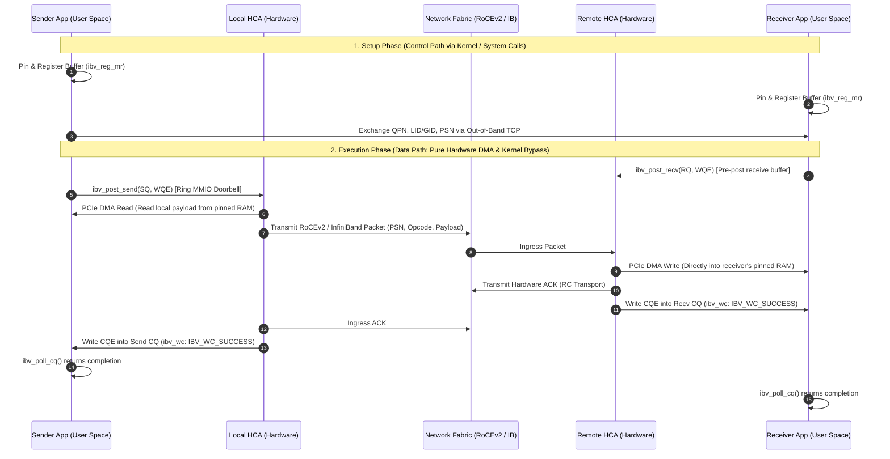
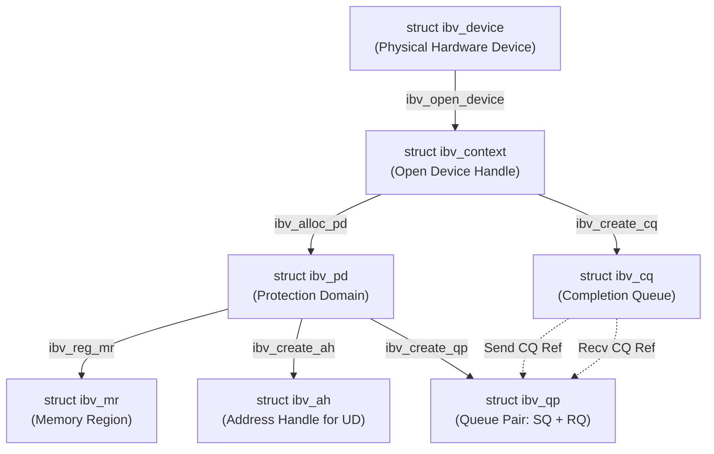
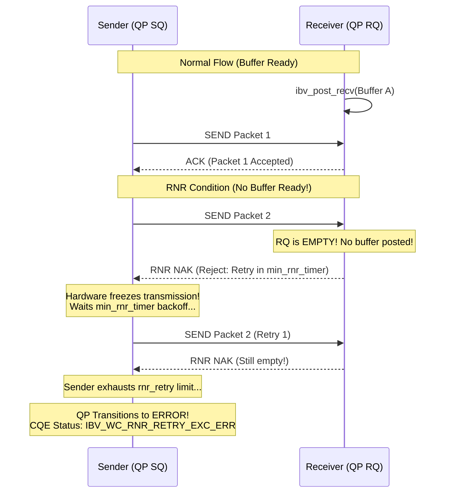

# Part 2: RDMA and Verbs Fundamentals

---

### 2.1 The RDMA Mental Model: Kernel Bypass, Zero-Copy, and the Data Path

#### Why it matters here
Every microsecond of latency you will measure in Deliverable D1 and every gigabyte per second of bandwidth in D2 depends on separating the **control path** from the **data path**. If your data path touches the kernel or causes a CPU memory copy, your low-latency guarantees evaporate.

#### Mental Model
Think of an operating system kernel like a bank teller. In traditional socket programming, every transaction requires standing in line at the window (a system call), handing over your cash (copying from user space to kernel space), having the teller inspect it, and waiting for the branch across town to verify receipt before you walk away.

RDMA builds a private, armored pneumatic tube directly between two bank vaults:
* **The Control Path (Setup)**: You still speak to the teller to establish credentials, register your vault boxes (Memory Regions), sign legal contracts (Queue Pairs), and establish mutual trust. This is slow and involves the kernel.
* **The Data Path (Transfer)**: Once established, you bypass the teller completely. You deposit a canister directly into the tube (post a descriptor) and hit a button on the wall (ring the doorbell). The pneumatic carrier moves the cash directly from Vault A to Vault B via mechanical forces (PCIe DMA). The teller never touches the money, and nobody context-switches.



#### Core Details: Step-by-Step Lifecycle of a Two-Sided `SEND`
1. **Receiver Pre-posts**: Receiver calls `ibv_post_recv()`. A Receive WQE (containing buffer address and `lkey`) is queued on the Receive Queue (RQ).
2. **Sender Posts**: Sender calls `ibv_post_send()`. A Send WQE is written to the Send Queue (SQ).
3. **Doorbell Ring**:
   * *Hardware RNIC*: Sender's user-space driver writes an MMIO register on the NIC (User Access Region, UAR). **Zero system calls.**
   * *Soft-RoCE (`rxe`)*: The user-space driver writes to an mmapped queue and calls `post_send_db()`, executing a `write()`/`ioctl()` system call on `/dev/infiniband/uverbsX` to alert the kernel thread.
4. **Local DMA Fetch**: The local HCA reads the user buffer over PCIe using physical bus addresses.
5. **Wire Transit**: The packet traverses the switch fabric (UDP port 4791 on RoCEv2).
6. **Remote DMA Ingress**: The remote HCA matches the packet's destination QPN, consumes the pre-posted Receive WQE, and DMAs the data directly into the registered memory address.
7. **Completions**: The remote HCA writes a CQE to the receiver's CQ. On Reliable Connection (RC), it transmits a transport-layer ACK. Upon receiving the ACK, the local HCA writes a CQE to the sender's Send CQ.

---

### 2.2 Verbs Resource Hierarchy, Ownership, and C++23 RAII

#### Why it matters here
In `allreduce/verbs_qp.h/.cc`, allocating and freeing verbs resources in the wrong order causes hard kernel driver panics, leaked physical memory pages, or cryptic `EBUSY` error codes.

#### The Verbs Object Hierarchy
Verbs objects form a strict parent-child directed acyclic graph. **A parent cannot be destroyed while any child holds a reference to it.**



#### Object Roles, Allocators, and Destructors

| Object | What it Represents | Allocator | Destructor | What Owns It |
|---|---|---|---|---|
| `ibv_device` | Enumerated physical/virtual adapter | `ibv_get_device_list()` | `ibv_free_device_list()` | Driver subsystem |
| `ibv_context` | Active communication instance | `ibv_open_device()` | `ibv_close_device()` | `ibv_device` |
| `ibv_pd` | Protection Domain (isolation boundary) | `ibv_alloc_pd()` | `ibv_dealloc_pd()` | `ibv_context` |
| `ibv_mr` | Pinned RAM + hardware translation | `ibv_reg_mr()` | `ibv_dereg_mr()` | `ibv_pd` |
| `ibv_cq` | Ring buffer for completion events | `ibv_create_cq()` | `ibv_destroy_cq()` | `ibv_context` |
| `ibv_qp` | Work request endpoint (SQ + RQ) | `ibv_create_qp()` | `ibv_destroy_qp()` | `ibv_pd` & `ibv_cq` |
| `ibv_ah` | Destination routing vector (for UD) | `ibv_create_ah()` | `ibv_destroy_ah()` | `ibv_pd` |

#### The Mandatory Destruction Order (Bottom-Up)
1. **Destroy Queue Pairs (`ibv_destroy_qp`)** and **Address Handles (`ibv_destroy_ah`)**.
2. **Destroy Completion Queues (`ibv_destroy_cq`)**. (Attempting to destroy a CQ while a QP is attached returns `EBUSY`).
3. **Deregister Memory Regions (`ibv_dereg_mr`)**. (Unpins physical memory pages).
4. **Deallocate Protection Domain (`ibv_dealloc_pd`)**. (Fails with `EBUSY` if any MR or QP still references it).
5. **Close Device Context (`ibv_close_device`)**.
6. **Free Device List (`ibv_free_device_list`)**.

#### Minimal Illustration: C++23 Generic RAII Resource Wrapper

```cpp
#include <infiniband/verbs.h>
#include <concepts>
#include <utility>

template <typename T, auto DeleterFunc>
    requires requires(T* ptr) { DeleterFunc(ptr); }
class VerbsResource {
public:
    constexpr VerbsResource() noexcept : handle_(nullptr) {}
    explicit VerbsResource(T* handle) noexcept : handle_(handle) {}
    ~VerbsResource() noexcept { reset(); }

    VerbsResource(const VerbsResource&) = delete;
    VerbsResource& operator=(const VerbsResource&) = delete;

    VerbsResource(VerbsResource&& other) noexcept : handle_(std::exchange(other.handle_, nullptr)) {}
    VerbsResource& operator=(VerbsResource&& other) noexcept {
        if (this != &other) { reset(); handle_ = std::exchange(other.handle_, nullptr); }
        return *this;
    }

    [[nodiscard]] T* get() const noexcept { return handle_; }
    [[nodiscard]] explicit operator bool() const noexcept { return handle_ != nullptr; }
    void reset() noexcept { if (handle_) { DeleterFunc(handle_); handle_ = nullptr; } }

private:
    T* handle_{nullptr};
};

// Aliases enforcing correct destruction signatures
using UniquePd = VerbsResource<ibv_pd, ibv_dealloc_pd>;
using UniqueMr = VerbsResource<ibv_mr, ibv_dereg_mr>;
using UniqueCq = VerbsResource<ibv_cq, ibv_destroy_cq>;
using UniqueQp = VerbsResource<ibv_qp, ibv_destroy_qp>;
using UniqueAh = VerbsResource<ibv_ah, ibv_destroy_ah>;
```

---

### 2.3 The Queue Pair State Machine (RC vs. UD)

#### Why it matters here
Queue Pairs are not created ready to transmit. They start in `RESET` and must be driven through a multi-step hardware state machine via `ibv_modify_qp()`. If a single attribute bitmask is omitted or invalid, `ibv_modify_qp()` returns `-1` (with `errno = EINVAL`), giving zero diagnostics as to which field failed.

```
       ┌─────────────── ibv_create_qp()
       ▼
   ┌───────┐   ibv_modify_qp()    ┌──────┐   ibv_modify_qp()    ┌─────┐   ibv_modify_qp()    ┌─────┐
   │ RESET │ ───────────────────► │ INIT │ ───────────────────► │ RTR │ ───────────────────► │ RTS │
   └───────┘                      └──────┘                      └─────┘                      └─────┘
                                                              (Ready to                    (Ready to
                                                               Receive)                      Send)
```

#### Reliable Connection (RC) State Machine Table

| Transition | Required Attributes (`struct ibv_qp_attr`) | Required Bitmask (`enum ibv_qp_attr_mask`) | Purpose / Why it Exists | Typical Error if Wrong |
|---|---|---|---|---|
| **RESET $\to$ INIT** | `qp_state = IBV_QPS_INIT`<br>`pkey_index = 0`<br>`port_num = 1`<br>`qp_access_flags` | `IBV_QP_STATE`<br>`IBV_QP_PKEY_INDEX`<br>`IBV_QP_PORT`<br>`IBV_QP_ACCESS_FLAGS` | Binds the QP to a physical port; enables remote write/read permissions. | `EINVAL`: Invalid `port_num` (must be 1 for single-port NICs). |
| **INIT $\to$ RTR**<br>*(Ready to Receive)* | `qp_state = IBV_QPS_RTR`<br>`path_mtu`<br>`dest_qp_num`<br>`rq_psn`<br>`max_dest_rd_atomic`<br>`min_rnr_timer`<br>`ah_attr` (Address Handle) | `IBV_QP_STATE`<br>`IBV_QP_AV`<br>`IBV_QP_PATH_MTU`<br>`IBV_QP_DEST_QPN`<br>`IBV_QP_RQ_PSN`<br>`IBV_QP_MAX_DEST_RD_ATOMIC`<br>`IBV_QP_MIN_RNR_TIMER` | Locks QP to the remote peer's QPN, initial receive packet sequence number, and network route. | `EINVAL`: `path_mtu` exceeds active MTU, or invalid GID index in `ah_attr`. |
| **RTR $\to$ RTS**<br>*(Ready to Send)* | `qp_state = IBV_QPS_RTS`<br>`sq_psn`<br>`timeout`<br>`retry_cnt`<br>`rnr_retry`<br>`max_rd_atomic` | `IBV_QP_STATE`<br>`IBV_QP_TIMEOUT`<br>`IBV_QP_RETRY_CNT`<br>`IBV_QP_RNR_RETRY`<br>`IBV_QP_SQ_PSN`<br>`IBV_QP_MAX_QP_RD_ATOMIC` | Initializes sender sequence number, hardware transport timers, and retry budgets. | `EINVAL`: `timeout` or `retry_cnt` missing from mask; hang on first send. |

#### Unreliable Datagram (UD) State Machine Table

> [!IMPORTANT]
> Notice the critical differences: UD is connectionless. In RTR, you **never** specify a remote destination QPN or Address Vector. In RTS, you **never** configure ACK timeouts or retry counters because UD has no hardware ACKs!

| Transition | Required Attributes (`struct ibv_qp_attr`) | Required Bitmask (`enum ibv_qp_attr_mask`) | Purpose / Why it Exists | Typical Error if Wrong |
|---|---|---|---|---|
| **RESET $\to$ INIT** | `qp_state = IBV_QPS_INIT`<br>`pkey_index = 0`<br>`port_num = 1`<br>`qkey = 0x11111111` | `IBV_QP_STATE`<br>`IBV_QP_PKEY_INDEX`<br>`IBV_QP_PORT`<br>`IBV_QP_QKEY` | Binds port and sets the 32-bit Queue Key required for datagram filtering. | `EINVAL`: `IBV_QP_QKEY` omitted from mask. |
| **INIT $\to$ RTR** | `qp_state = IBV_QPS_RTR` | `IBV_QP_STATE` | Moves QP to receive state. Requires **no destination parameters**. | `EINVAL`: Supplying `IBV_QP_AV` or `IBV_QP_DEST_QPN` (UD has no fixed peer). |
| **RTR $\to$ RTS** | `qp_state = IBV_QPS_RTS`<br>`sq_psn` | `IBV_QP_STATE`<br>`IBV_QP_SQ_PSN` | Initializes local send packet sequence number. No retry flags allowed. | `EINVAL`: Supplying `IBV_QP_TIMEOUT` or `IBV_QP_RETRY_CNT`. |

---

### 2.4 Verbs Operations: SEND/RECV, RDMA_WRITE, RDMA_WRITE_WITH_IMM, RDMA_READ

#### Why it matters here
In D1, you contrast two-sided (`SEND/RECV`) with one-sided (`RDMA_WRITE`). In D2 (Ring All-Reduce), your choice determines whether the receiving CPU must actively participate in chunk transfers or can stay asleep until the transfer completes.

#### Operation Semantics Comparison Table

| Operation Opcode | Transfer Type | Initiator Generates CQE? | Responder Generates CQE? | Consumes Posted Recv WR? | Remote CPU Involved? | Max Size Limit |
|---|---|---|---|---|---|---|
| `IBV_WR_SEND` | Two-Sided | Yes (if signaled) | **Yes** (`IBV_WC_RECV`) | **Yes** | Yes (must poll CQ) | Up to 1GB (RC) / Active MTU (UD) |
| `IBV_WR_RDMA_WRITE` | One-Sided | Yes (if signaled) | **No** (Silent DMA) | **No** | **Zero** | 1GB+ (RC only) |
| `IBV_WR_RDMA_WRITE_WITH_IMM` | One-Sided + Notification | Yes (if signaled) | **Yes** (`IBV_WC_RECV` with `imm_data`) | **Yes** | Yes (wakes on CQE) | 1GB+ (RC only) |
| `IBV_WR_RDMA_READ` | One-Sided Inbound | Yes (when data returned) | **No** (Silent DMA) | **No** | **Zero** | 1GB+ (RC only) |

#### Semantics & Selection Criteria
1. **`IBV_WR_SEND` / `IBV_WR_RECV` (Two-Sided)**:
   * *Mechanism*: Sender does not know *where* the data lands in remote memory. The receiver decides by pre-posting an `ibv_recv_wr` containing its local SGE.
   * *When to use*: Control messages, parameter exchange, or when buffer ownership shifts dynamically.
2. **`IBV_WR_RDMA_WRITE` (One-Sided Pure)**:
   * *Mechanism*: Sender specifies the remote virtual memory address (`wr.wr.rdma.remote_addr`) and authorization key (`wr.wr.rdma.rkey`). The remote HCA writes directly to host RAM. The remote CPU is never interrupted and receives no CQE.
   * *The Problem*: How does the receiver know the write finished? You must resort to polling on a memory flag (dirty memory polling).
3. **`IBV_WR_RDMA_WRITE_WITH_IMM` (The Industry Standard for Collectives)**:
   * *Mechanism*: Performs a pure zero-copy DMA write directly into remote memory, but **also pushes a 32-bit immediate data integer** (`wr.imm_data`) into the remote Completion Queue.
   * *Why it wins*: The data transfer is zero-copy (doesn't consume an SGE buffer on the receiver), but it consumes a posted receive request and generates a CQE on the remote side, alerting the remote CPU that "Chunk $k$ has arrived!"

---

### 2.5 Data-Path Optimizations: Inline Sends, Selective Signaling, and Batching

#### Why it matters here
In Deliverable D1, naive verbs code achieves 15 µs ping-pong latency. Applying inline sends, selective signaling, and doorbell batching drops latency to the physical limits of Soft-RoCE (~5–8 µs) or real hardware (~1 µs).

#### 1. Inline Sends (`IBV_SEND_INLINE`)
* **Mental Model**: Instead of telling the NIC "go fetch my data from RAM at address $X$ via PCIe DMA", you copy the payload directly into the Work Request struct itself.
* **Mechanism**: When you set `send_wr.send_flags = IBV_SEND_INLINE`, the user-space driver copies the buffer directly into the WQE inside the QP's Send Queue.
* **Benefits**:
  1. Eliminates one PCIe read transaction across the host bus.
  2. You can immediately overwrite or free your user buffer as soon as `ibv_post_send()` returns.
* **Limit**: The payload cannot exceed `max_inline_data` queried during `ibv_create_qp()` (typically 64 to 256 bytes).

#### 2. Selective Signaling
* **Mental Model**: If you post 1,000 packets and poll 1,000 completion events, your CPU spends 40% of its time processing CQ overhead.
* **Mechanism**:
  1. When creating the QP (`ibv_qp_init_attr`), set `sq_sig_all = 0`.
  2. For regular sends, do **not** set `IBV_SEND_SIGNALED`. The HCA transmits the packet silently; **no CQE is generated**.
  3. Set `IBV_SEND_SIGNALED` on every $N$-th send (e.g., every 32nd packet).
* **The Golden Rule**: You **must** poll the CQ for that $N$-th completion. Completed unsignaled WQEs remain on the Send Queue until a subsequent signaled WQE completes, which retires all prior WQEs. If you never signal, the Send Queue fills up and `ibv_post_send` fails with `ENOMEM`.

#### 3. Work Request Chaining (Doorbell Amortization)
* **Mental Model**: Ringing the doorbell for every packet is like making a separate phone call for every item on your grocery list. Chaining links the list together so you make one phone call.
* **Mechanism**: Multiple `ibv_send_wr` structures are chained via the `.next` pointer. A single call to `ibv_post_send()` enqueues the entire chain and rings the doorbell once.

```cpp
// Minimal Illustration: Work Request Chaining & Inline Send (<25 lines)
struct ibv_send_wr wr[2]{}, *bad_wr{nullptr};
struct ibv_sge sge[2]{};

// First WR: Inlined small control message (Unsignaled)
sge[0] = { .addr = reinterpret_cast<uint64_t>(&ctrl_msg), .length = sizeof(ctrl_msg), .lkey = 0 };
wr[0].sg_list = &sge[0]; wr[0].num_sge = 1;
wr[0].opcode = IBV_WR_SEND;
wr[0].send_flags = IBV_SEND_INLINE; // No DMA read, lkey ignored
wr[0].next = &wr[1];                // Chain to next WR

// Second WR: Payload DMA Send (Signaled to retire both WQEs)
sge[1] = { .addr = reinterpret_cast<uint64_t>(buf), .length = len, .lkey = mr->lkey };
wr[1].sg_list = &sge[1]; wr[1].num_sge = 1;
wr[1].opcode = IBV_WR_SEND;
wr[1].send_flags = IBV_SEND_SIGNALED;
wr[1].next = nullptr;

ibv_post_send(qp, &wr[0], &bad_wr); // One doorbell rings for both WRs!
```

---

### 2.6 Memory Registration in Depth

#### Why it matters here
In Project Adder, memory registration (`ibv_reg_mr`) is the single most expensive control-path operation. If you call `ibv_reg_mr` inside your timed latency loop, your benchmark is profiling Linux virtual memory page table locking, not RDMA network latency.

#### Mental Model
Virtual memory is an illusion maintained by the OS kernel. A virtual pointer `0x7fff0000` might point to physical page `0x104000` right now, but five milliseconds from now the Linux virtual memory manager might swap that page to disk or move it to balance NUMA nodes.

Network hardware does not understand virtual page tables. It requires **pinned physical addresses**. `ibv_reg_mr` freezes those pages in physical RAM and programs the physical page table into the NIC's internal translation cache (Translation and Protection Table, TPT).

```
Virtual Address Space               Linux Page Table                 Physical RAM Pages
[ 0x7fff1000 - 0x7fff2000 ] ────► [ VPN 0x7fff1 ──► PFN 0x4120 ] ────► [ Physical Page 0x4120 ] (PINNED!)
                                                                                ▲
                                                                                │ PCIe DMA
                                    HCA Hardware Translation Table (TPT)        │
                                    [ lkey / rkey 0x8a12 ] ─────────────────────┘
```

#### The Registration Cost Breakdown
Registering 1 GB of memory can take **tens to hundreds of milliseconds**:
1. `sys_mlock()`: Linux walks the process page table, allocates physical pages for any unmapped virtual addresses, and marks them `VM_LOCKED`.
2. `ib_umem_get()`: Pinning page reference counts so Linux cannot swap them.
3. **IOMMU / DMA Mapping**: Translating CPU physical addresses to PCIe I/O Virtual Addresses (IOVA).
4. **HCA Firmware Registration**: Programming the hardware TPT entries over the PCIe bus.

#### Registration Cost Rule of Thumb
* Registering memory costs approximately **10 to 50 microseconds per megabyte** of pinned buffer space.
* **The Rule**: **Allocate and register all memory buffers once at program startup.** Never allocate or register memory on the hot path. Use a pre-registered pool (such as `shared/free_list_pool.h`).

#### Hugepages (2 MB / 1 GB Pages)
Standard Linux uses 4 KB memory pages. A 1 GB buffer requires **262,144 page entries** to be pinned and cached in the HCA TPT. Using 2 MB hugepages reduces this to **512 entries**.
* Drastically accelerates `ibv_reg_mr()`.
* Eliminates HCA address translation cache misses (TPT misses) during large transfers, preventing multi-microsecond PCIe latency spikes.

```cpp
// Allocate memory using 2MB Hugepages for zero-copy RDMA pools (<25 lines)
#include <sys/mman.h>
#include <cstdlib>

void* allocate_hugepage_buffer(size_t size) {
    // Round up size to multiple of 2MB
    size_t rounded_size = (size + (2 * 1024 * 1024 - 1)) & ~(2 * 1024 * 1024 - 1);
    void* ptr = mmap(nullptr, rounded_size,
                     PROT_READ | PROT_WRITE,
                     MAP_PRIVATE | MAP_ANONYMOUS | MAP_HUGETLB,
                     -1, 0);
    return (ptr == MAP_FAILED) ? nullptr : ptr;
}
```

---

### 2.7 Flow Control and the RNR (Receiver Not Ready) Death Spiral

#### Why it matters here
In Deliverable D2, failing to implement flow control causes the sender to blast chunks faster than the receiver can post buffers, triggering an **RNR NAK death spiral** that destroys P99.9 tail latency or crashes the QP with `IBV_WC_RNR_RETRY_EXC_ERR`.

#### Mental Model
Imagine an automatic baseball pitching machine (the sender) firing balls into a catcher's mitt. If the catcher hasn't put on a fresh mitt before the next ball arrives, the ball strikes the catcher in the chest. In RDMA, the catcher throws a yellow penalty flag (an **RNR NAK packet**) back at the machine, and the pitching machine stops, waits on a hardware timer, and tries pitching the exact same ball again.



#### Core Details: Hardware RNR Configuration
When moving an RC Queue Pair through `INIT -> RTR -> RTS`, two parameters govern this behavior:
1. `min_rnr_timer` (Configured in **RTR**): A 5-bit encoded value specifying how long the sender must wait before retrying when this receiver sends an RNR NAK:

| Encoded Value | Backoff Delay |
|---|---|
| `0` | 655.36 ms (Extremely long! Destroys latency) |
| `1` | 0.01 ms ($10\ \mu\text{s}$) |
| `12` | 0.32 ms ($320\ \mu\text{s}$) |
| `31` | 491.52 ms |

2. `rnr_retry` (Configured in **RTS**): A 3-bit value specifying how many times the local HCA will retry sending a packet that received an RNR NAK:
   * Values `0` to `6`: Retry exactly that many times. If the receiver still has no buffer, fail with `IBV_WC_RNR_RETRY_EXC_ERR`.
   * Value `7`: **Retry infinitely.** (Prevents crashes, but stalls your queue and blows up tail latency if the receiver lags).

#### The Solution: Credit-Based Flow Control via SPSC Ring Buffer
Never rely on RNR retries. In `allreduce/ring.cc`, use the lock-free SPSC circular buffer from `shared/ring_buffer.h` as a credit tracker:
* The receiver issues credits to the sender indicating how many receive buffers are currently posted.
* The sender maintains a credit balance: `assert(available_credits > 0);` before posting a Send.

---

### 2.8 RoCEv2 and GIDs: The IPv4-Mapped Address Trap

#### Why it matters here
On pure InfiniBand fabrics, routing uses 16-bit Local Identifiers (LIDs). On Ethernet (RoCEv2), **LIDs are zero**. Routing is governed entirely by 128-bit Global Identifiers (GIDs). Specifying the wrong GID index during QP configuration is the #1 reason beginners spend 3 days staring at silent timeouts.

#### Mental Model: The GID Table
Every RDMA port maintains a table of GID entries queried via `ibv_query_gid()`. On Linux Soft-RoCE (`rxe0`):
* **Index 0**: Contains a link-local IPv6 address generated from your MAC address (`fe80::...`).
* **Index 1**: Contains an **IPv4-Mapped IPv6 address** corresponding to your Ethernet interface's IPv4 address (`::ffff:192.168.1.50`).

```
Linux GID Table (/sys/class/infiniband/rxe0/ports/1/gids/):
┌───────┬──────────────────────────────────────────┬──────────────────────┐
│ Index │ Raw 128-bit Hex Representation           │ Protocol / Type      │
├───────┼──────────────────────────────────────────┼──────────────────────┤
│   0   │ fe80:0000:0000:0000:0215:5dff:fe20:abcd   │ RoCEv2 (Link-Local)  │
│   1   │ 0000:0000:0000:0000:0000:ffff:c0a8:0132   │ RoCEv2 (IPv4 Mapped) │
└───────┴──────────────────────────────────────────┴──────────────────────┘
```

#### The Trap and Confirmation
If your client application connects over standard IPv4 sockets, exchanges IP addresses, but configures the Queue Pair `ah_attr.grh.sgid_index = 0`, the HCA will emit RoCEv2 packets with link-local source addresses. Intermediate switches or the remote kernel will drop the packets. The sender will wait until `timeout` expires and abort with `IBV_WC_RETRY_EXC_ERR`.

#### How to verify GID entries in Linux:
```bash
cat /sys/class/infiniband/rxe0/ports/1/gids/1
cat /sys/class/infiniband/rxe0/ports/1/gid_attrs/types/1
# Should output: RoCE v2
```

---

### 2.9 What Soft-RoCE (`rdma_rxe`) Changes: Emulation vs. Silicon

#### Why it matters here
In your project documentation and README, you must present your experimental data with scientific integrity. If you claim your RDMA library achieves "zero-copy kernel bypass" when running over Soft-RoCE, reviewers will reject your claims.

#### Hardware RNIC vs. Soft-RoCE Architectural Comparison

| Architectural Dimension | Hardware RNIC (e.g., ConnectX-5/6) | Soft-RoCE (`rdma_rxe` on Linux) |
|---|---|---|
| **Data-Path Execution** | Dedicated on-chip ASIC microcode | Linux kernel threads (`rxe_worker`) |
| **Doorbell Mechanism** | Direct MMIO write to PCIe UAR register | System call (`write`/`ioctl` on `cmd_fd`) |
| **Data Copying** | Zero-copy PCIe DMA directly to host RAM | CPU memory copy into UDP kernel `sk_buff` |
| **Transport Layer ACKs** | Generated by hardware state machines in $< 1\ \mu\text{s}$ | Handled by kernel network stack interrupt handlers |
| **One-Way Ping-Pong Latency** | **$0.6\ \mu\text{s} - 1.5\ \mu\text{s}$** | **$5.0\ \mu\text{s} - 25.0\ \mu\text{s}$** |
| **CPU Core Utilization** | 0% (CPU can spin or sleep freely) | High (CPU executes the entire network stack) |

#### How to Present Your Results
State explicitly in every benchmark document:
> *"All benchmarks were conducted over Soft-RoCE (`rdma_rxe`), which executes the RoCEv2 transport protocol in Linux kernel software. The latency and bandwidth numbers reported reflect CPU cache hierarchies, kernel socket traversal, and thread scheduling latencies, rather than the physical propagation delay of hardware ASIC network adapters."*

---

### 2.10 The Verbs Debugging Playbook: Decoding `ibv_wc_status`

When an asynchronous operation fails, `ibv_poll_cq()` returns an `ibv_wc` completion where `status != IBV_WC_SUCCESS`. Consult this table immediately:

| Completion Status (`ibv_wc_status`) | Error Name | Root Cause | Exact Verification & Fix Procedure |
|---|---|---|---|
| **1** | `IBV_WC_LOC_LEN_ERR`<br>*(Local Length Error)* | The receive buffer posted is smaller than the incoming message payload, OR UD buffer omitted the 40-byte GRH. | Check `sge.length`. On **UD receives**, verify you allocated `length = msg_size + 40` bytes for the Global Routing Header. |
| **4** | `IBV_WC_LOC_PROT_ERR`<br>*(Local Protection Error)* | The local buffer's `lkey` does not match the memory region, OR buffer lacks write permission during a local receive. | Verify `sge.lkey == mr->lkey`. If posting a receive, verify the MR was registered with `IBV_ACCESS_LOCAL_WRITE`. |
| **5** | `IBV_WC_WR_FLUSH_ERR`<br>*(Work Request Flushed)* | The Queue Pair transitioned to the `ERROR` state due to an earlier fatal failure on another request. | Inspect the *first* failed CQE on the queue. Once a QP enters `ERROR`, all pending WQEs are flushed with this code. |
| **10** | `IBV_WC_REM_ACCESS_ERR`<br>*(Remote Access Error)* | For `RDMA_WRITE` or `RDMA_READ`: Remote address is invalid, or `rkey` is wrong, or remote MR lacks remote write access. | Verify the remote MR was registered with `IBV_ACCESS_REMOTE_WRITE`. Verify the remote virtual address has not moved. |
| **12** | `IBV_WC_RETRY_EXC_ERR`<br>*(Transport Retry Counter Exceeded)* | The sender never received an ACK packet. The connection dropped, the remote peer crashed, or routing is broken. | 1. Wrong GID index used in `ah_attr`.<br>2. Remote QP was never transitioned to `RTR`/`RTS`.<br>3. Active MTU mismatch between peers. |
| **13** | `IBV_WC_RNR_RETRY_EXC_ERR`<br>*(RNR Retry Counter Exceeded)* | Sender transmitted data, but receiver had no pre-posted receive buffers, exhausting the `rnr_retry` limit. | 1. Ensure `ibv_post_recv()` completes *before* the remote sender issues `ibv_post_send()`.<br>2. Implement SPSC credit flow control. |

---

### Self-Check Questions (Part 2)

1. In what exact order must you destroy an `ibv_context`, `ibv_pd`, `ibv_mr`, `ibv_cq`, and `ibv_qp` to avoid `EBUSY` kernel errors?
2. During the QP state transition for an Unreliable Datagram (UD) Queue Pair, why does setting `IBV_QP_DEST_QPN` or `IBV_QP_TIMEOUT` cause `ibv_modify_qp()` to fail?
3. Why does `IBV_WR_RDMA_WRITE_WITH_IMM` eliminate the primary limitation of pure `IBV_WR_RDMA_WRITE` in collective communication?
4. If an application posts an unsignaled send (`sq_sig_all = 0`, no `IBV_SEND_SIGNALED`), what happens if it never posts a signaled send afterward?

<details>
<summary><b>Click to View Answers</b></summary>

1. **Answer**: Bottom-up order:
   `ibv_destroy_qp` $\to$ `ibv_destroy_cq` $\to$ `ibv_dereg_mr` $\to$ `ibv_dealloc_pd` $\to$ `ibv_close_device`.
   Children holding references to parents (e.g., QP referencing CQ/PD, or MR referencing PD) will block deallocation with `EBUSY`.
2. **Answer**: UD is connectionless and unreliable. A UD QP can send packets to any remote UD QP on the fabric, so it has no single fixed destination QPN configured at state transition time (the destination QPN and Address Handle are supplied per-message in the `ibv_send_wr`). Furthermore, UD has no hardware ACKs or retransmissions, so transport timers (`timeout`) and retry counters are illegal.
3. **Answer**: Pure `RDMA_WRITE` is completely silent on the receiving side: the data is written directly to memory via DMA, but no CQE is generated, leaving the receiver no clean way to know the transfer finished. `RDMA_WRITE_WITH_IMM` writes the data via zero-copy DMA *and* generates a completion event on the receiver's CQ containing a 32-bit immediate data integer, alerting the remote CPU immediately.
4. **Answer**: The Send Queue (SQ) will eventually fill up. Even though unsignaled sends do not produce Completion Queue Elements, the WQE descriptors remain occupied on the Send Queue ring buffer until a subsequent signaled WQE completes, which retires all preceding WQEs. If no signaled send is ever posted, `ibv_post_send()` will eventually return `ENOMEM`.
</details>

---

### 2.11 If You Remember Nothing Else (Part 2)
1. Verbs objects have strict lifecycle ownership: destroy QPs and CQs before deregistering MRs, and deregister MRs before deallocating the Protection Domain.
2. The RC QP state machine requires careful attribute masks: missing one bitmask flag causes `ibv_modify_qp` to fail with an unhelpful `EINVAL`.
3. Pre-post receive buffers *before* the sender posts sends; relying on hardware RNR retries wrecks P99.9 tail latency and risks connection termination.
4. Register memory buffers once outside the benchmark loop; memory registration costs 10–50 µs per megabyte because the kernel must pin physical pages.
5. In Soft-RoCE, `ibv_post_send` issues a system call to trigger the kernel worker; it provides the programming model of RDMA, but not the physical kernel bypass of hardware ASICs.
